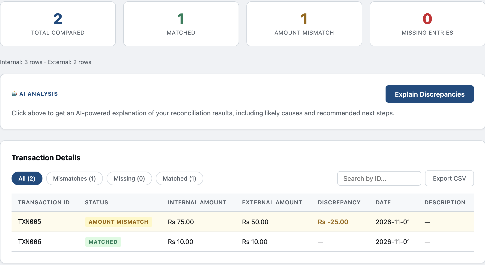
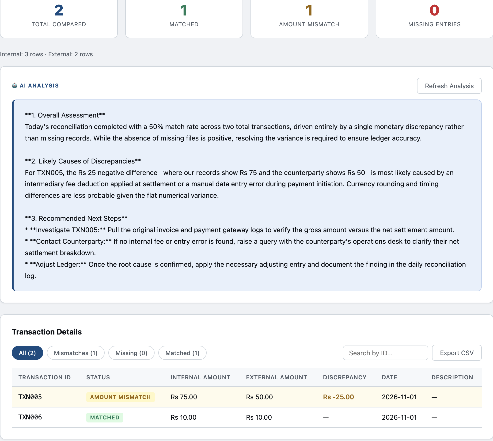
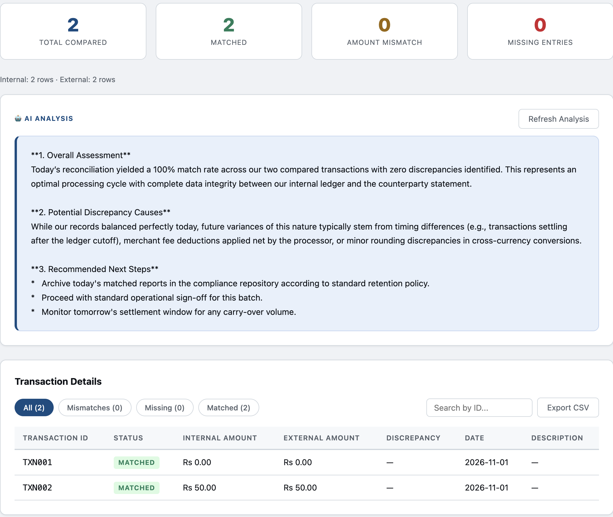
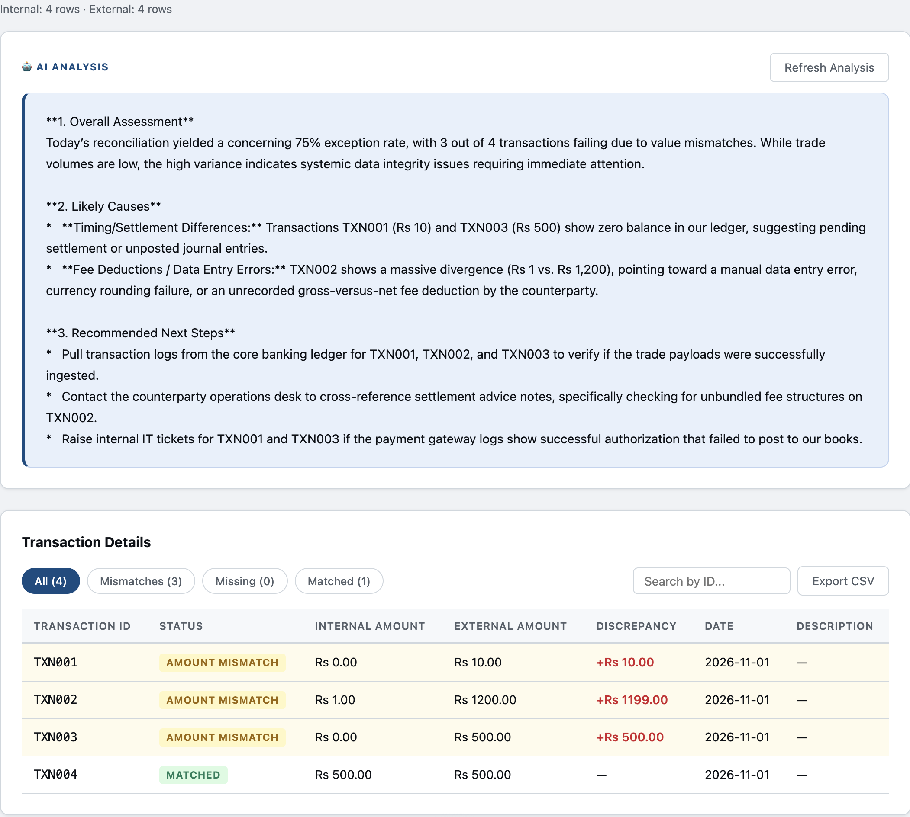
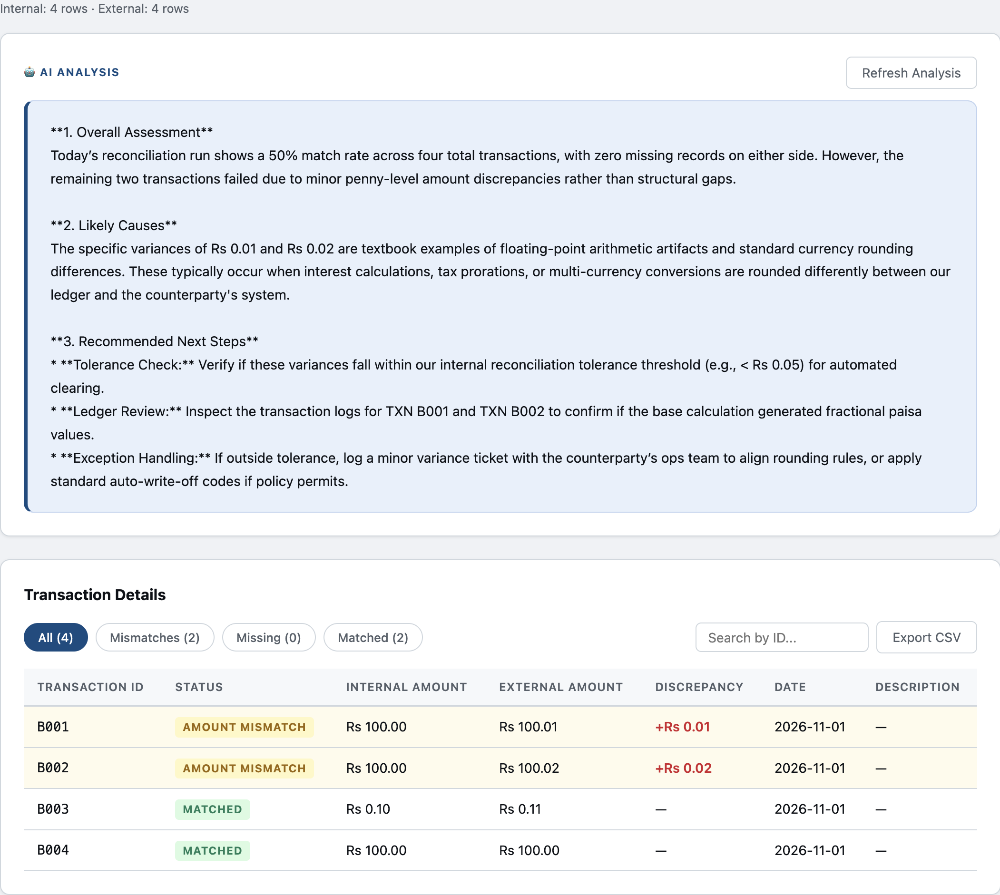
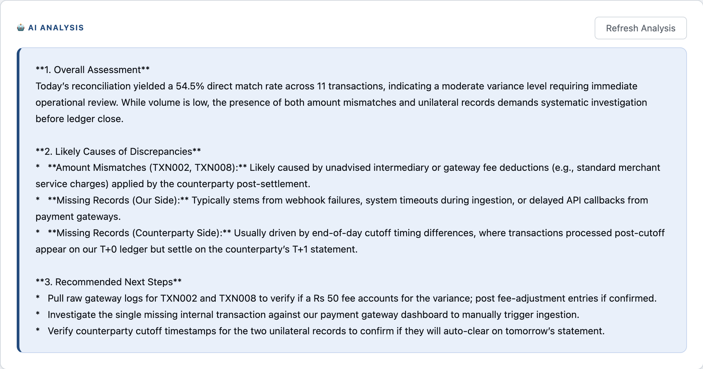
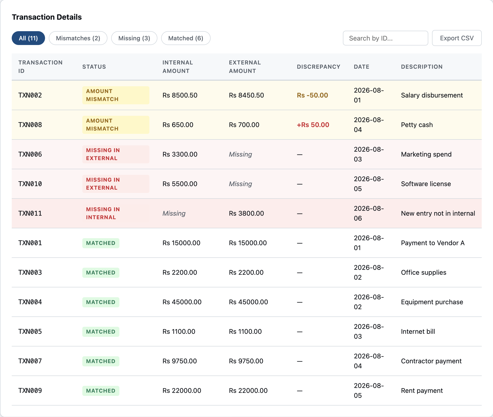
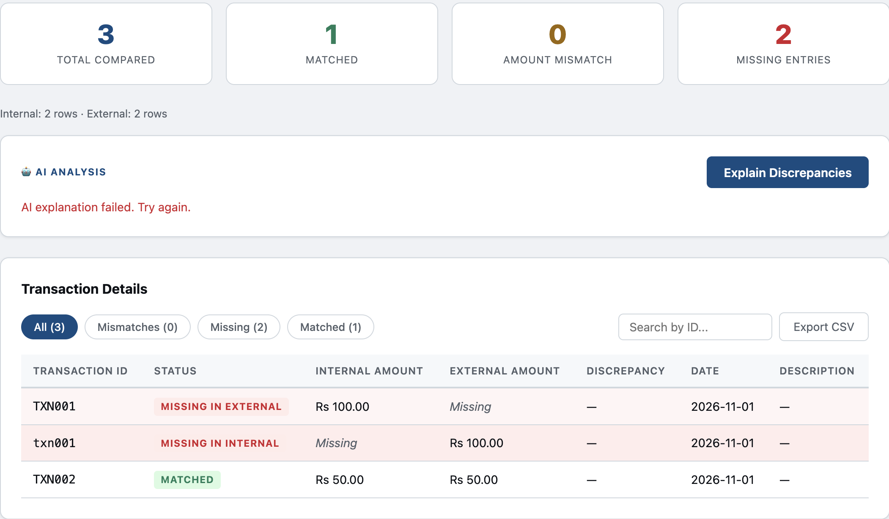

# ReconX: manual QA report

Tester: Ritanshu Gautam. Application: [ReconX](https://reconx-mu.vercel.app) (live deployment). Tested 16 Nov 2026 in Brave on macOS.

**Result:** 7 manual test cases executed (2 passed, 5 failed). 7 defects reported as [GitHub Issues](https://github.com/ritanshugautam/reconx/issues): 3 High, 2 Medium, 2 Low.

## Approach

Black-box manual testing of the deployed app. For each test I designed a small pair of CSV files (internal ledger and counterparty statement) with a known correct outcome, ran them through the live app, and compared the result with the expected outcome. Every case has a screenshot. Likely causes were found by reading the backend code after the failure was observed.

## Results at a glance

| ID | Scenario | Result | Severity | Defect |
|---|---|---|---|---|
| T01 | Smoke test: sample files from my own repo | Pass | - | DEF-05, DEF-06 |
| T03 | Tolerance boundary (0.01) | Fail | Medium | DEF-04 |
| T04 | ID case: TXN001 vs txn001 | Fail | Low | DEF-07 |
| T06 | Duplicate ID inside one file | Fail | High | DEF-01 |
| T07 | Blank amount vs 0.00 | Fail | High | DEF-02 |
| T08 | Odd amount formats | Fail | High | DEF-03 |
| T09 | Negative and zero amounts | Pass | - | - |

T01 passed on the reconciliation counts; DEF-05 and DEF-06 are defects in the AI analysis that I found during it.

Full log with expected and actual results: [test-log.csv](test-log.csv). Test data: [test-data/](test-data/). Screenshots: [evidence/](evidence/).

## Defects

### DEF-01 (High): Duplicate IDs in one file are silently dropped, causing a false mismatch ([issue #1](https://github.com/ritanshugautam/reconx/issues/1))

Found by T06. 

**Steps**

1. Open the live app.
2. Upload T06_duplicate_id_internal.csv as the internal file (TXN005 appears twice: 50.00 and 75.00; TXN006 = 10.00).
3. Upload T06_duplicate_id_external.csv as the external file (TXN005 = 50.00; TXN006 = 10.00).
4. Click Run.

**Expected:** The duplicate is flagged or rejected, and all 3 internal rows are accounted for on screen.

**Actual:** The header says Internal 3 rows, External 2 rows, but only 2 transactions are compared and no warning appears. TXN005 shows Amount Mismatch (internal 75.00 vs external 50.00, discrepancy -25.00). The first TXN005 row (50.00) equals the external amount but was dropped silently, so the mismatch is false. The AI analysis then explained it as a fee deduction or data-entry error.

**Likely cause:** backend/routes/reconcile.js, lines 61-65: internalMap.set(String(r.id).trim(), r) replaces any earlier row with the same ID, so the last row wins and nothing reports the overwrite.

### DEF-02 (High): Blank amount is read as 0.00 and shown as Matched ([issue #2](https://github.com/ritanshugautam/reconx/issues/2))

Found by T07. 

**Steps**

1. Open the live app.
2. Upload T07_blank_amount_internal.csv as the internal file (TXN001 amount is blank; TXN002 = 50.00).
3. Upload T07_blank_amount_external.csv as the external file (TXN001 = 0.00; TXN002 = 50.00).
4. Click Run.

**Expected:** TXN001 is flagged as invalid and is not shown as Matched.

**Actual:** TXN001 is shown as Matched with Rs 0.00 on the internal side and no warning anywhere. The AI analysis then reported a 100% match rate with "complete data integrity" and advised standard sign-off.

**Likely cause:** backend/routes/reconcile.js, line 24: parseFloat(row[amtKey]) || 0 turns a blank amount into 0, so it is indistinguishable from a real 0.00.

### DEF-03 (High): Formatted or non-numeric amounts are misread as 1.00 or 0.00 with no warning ([issue #3](https://github.com/ritanshugautam/reconx/issues/3))

Found by T08. 

**Steps**

1. Open the live app.
2. Upload T08_amount_formats_internal.csv as the internal file (amounts: abc, "1,200.00", a currency symbol followed by 500, and 500 INR).
3. Upload T08_amount_formats_external.csv as the external file (10.00, 1200.00, 500.00, 500.00).
4. Click Run.

**Expected:** No row is silently read as 0. "1,200.00" equals 1200.00 and is Matched; "abc" is flagged or rejected.

**Actual:** "abc" was read as Rs 0.00, "1,200.00" as Rs 1.00 (discrepancy +1199.00), the currency-symbol amount as Rs 0.00, and "500 INR" as Rs 500.00 (Matched). There was no warning on any row. The AI analysis explained the errors as pending settlement and data-entry mistakes.

**Likely cause:** backend/routes/reconcile.js, line 24: parseFloat stops at the comma in "1,200.00" (result 1) and returns NaN for text that does not start with a digit; || 0 then hides the NaN.

### DEF-04 (Medium): Tolerance check gives different results for the same 0.01 difference ([issue #4](https://github.com/ritanshugautam/reconx/issues/4))

Found by T03. 

**Steps**

1. Open the live app.
2. Upload T03_tolerance_internal.csv as the internal file (B001 = 100.00, B002 = 100.00, B003 = 0.10, B004 = 100.00).
3. Upload T03_tolerance_external.csv as the external file (B001 = 100.01, B002 = 100.02, B003 = 0.11, B004 = 100.005).
4. Click Run.

**Expected:** Amounts that differ by the same value get the same result: B001 and B003 (both 0.01) are Matched, B004 (0.005) is Matched, B002 (0.02) is Amount Mismatch.

**Actual:** B001 (100.00 vs 100.01) is Amount Mismatch but B003 (0.10 vs 0.11) is Matched, although both differ by 0.01. B002 is Amount Mismatch; B004 is Matched. B004's external amount is displayed as 100.00 although the file value is 100.005.

**Likely cause:** backend/routes/reconcile.js, line 78: Math.abs(intRow.amount - extRow.amount) < 0.01 compares floating-point numbers. In JavaScript 100.01 - 100.00 = 0.010000000000005116 (not < 0.01, so mismatch) while 0.11 - 0.10 = 0.009999999999999995 (< 0.01, so matched).

### DEF-05 (Medium): AI analysis names a cause the data contradicts (fee deduction for an amount that went up) ([issue #5](https://github.com/ritanshugautam/reconx/issues/5))

Found by T01. 

**Steps**

1. Open the live app.
2. Upload sample_internal.csv as the internal file and sample_external.csv as the external file (both in the repo root).
3. Click Run, then click Explain Discrepancies and read the AI analysis.

**Expected:** Each suggested cause is consistent with the data: TXN002 external is 50.00 lower than internal, TXN008 external is 50.00 higher.

**Actual:** The AI attributed both mismatches to counterparty fee deductions and told the reader to check a Rs 50 fee for both. A fee deduction lowers the external amount, so it cannot explain TXN008, where the external amount is higher (+50.00).

**Likely cause:** backend/routes/explain.js, lines 35-39: the prompt asks for "the most likely causes (be specific - ... fee deductions ...)" and gives the model only counts and sample amounts, with no instruction to say when the data cannot support a cause.

### DEF-06 (Low): AI analysis shows raw markdown symbols (** and *) ([issue #6](https://github.com/ritanshugautam/reconx/issues/6))

Found by T01. 

**Steps**

1. Open the live app.
2. Upload sample_internal.csv and sample_external.csv (repo root) and click Run.
3. Click Explain Discrepancies and read the AI analysis box.

**Expected:** The analysis is displayed formatted: headings and bullets, with no raw markdown symbols.

**Actual:** The text shows literal characters such as "**1. Overall Assessment**" and "*" bullets. I saw this on every AI output so far (checked in the T01, T04, T06, T03, T08 and T09 runs).

**Likely cause:** src/components/AIExplainer.jsx, line 78: the model's markdown string is rendered as plain text inside a div.

### DEF-07 (Low): Transaction IDs that differ only by letter case are treated as different transactions ([issue #7](https://github.com/ritanshugautam/reconx/issues/7))

Found by T04. 

**Steps**

1. Open the live app.
2. Upload T04_id_case_internal.csv as the internal file (TXN001 = 100.00, TXN002 = 50.00).
3. Upload T04_id_case_external.csv as the external file (txn001 = 100.00, TXN002 = 50.00).
4. Click Run.

**Expected:** TXN001 and txn001 resolve to the same transaction: 2 Matched, 0 Missing.

**Actual:** TXN001 shows as Missing in External and txn001 as Missing in Internal, on two separate rows; only TXN002 is Matched. It fails visibly (both rows shown), not silently. The README lists this as a known limitation.

**Likely cause:** backend/routes/reconcile.js, lines 62 and 65: IDs are trimmed with String(r.id).trim() but not case-normalised.

## Other observations

- Cold start: my first Run after idle took about 27 s (free-tier backend waking up); warm reconciles took 1-2 s.
- AI analysis took 3-4 s in most runs and 12-14 s once; one first attempt failed after 1-3 s with "AI explanation failed. Try again." and the retry worked.
- The summary card shows Missing in External and Missing in Internal as one combined number; the split is visible only in the table.
- Test T09 (negative and zero amounts) passed, and the AI correctly named a sign inversion as the likely cause.

## Not yet run

Planned but not yet executed: identical files on both sides (T02), ID whitespace, 10,000 / 10,001-row cap, empty and header-only files, wrong headers, split debit/credit columns, special characters, mobile layout.

## Passing tests

T01 (smoke test) and T09 (negative and zero amounts) matched the expected results; screenshots are in the evidence folder.
