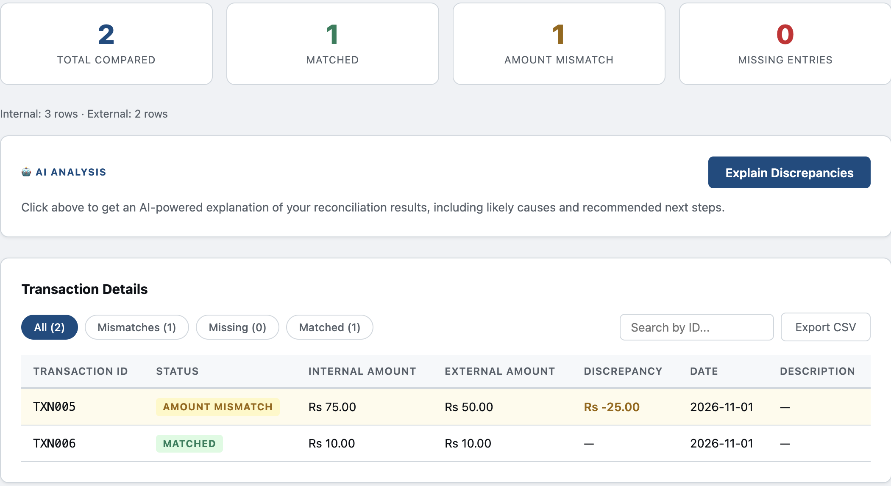
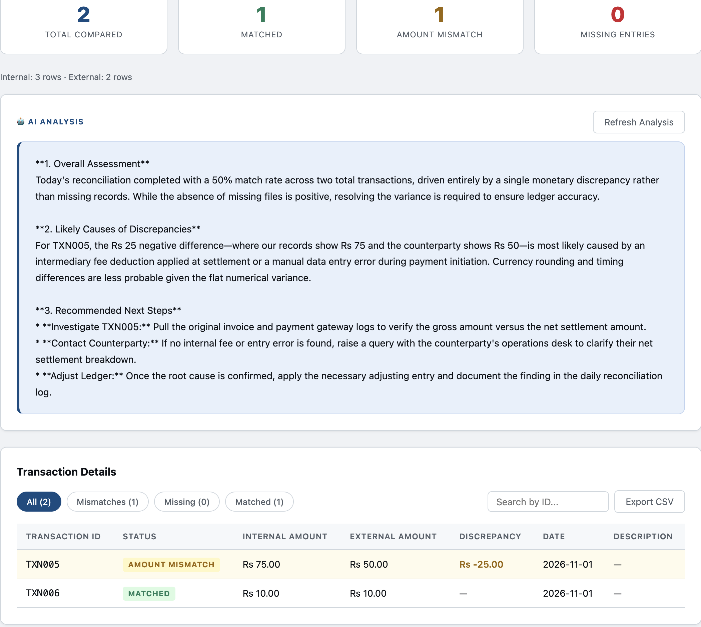

**Severity:** High  
**Found by:** test case T06 (manual testing of the live app)  
**Defect ID:** DEF-01

## Steps to reproduce
1. Open the live app.
2. Upload T06_duplicate_id_internal.csv as the internal file (TXN005 appears twice: 50.00 and 75.00; TXN006 = 10.00).
3. Upload T06_duplicate_id_external.csv as the external file (TXN005 = 50.00; TXN006 = 10.00).
4. Click Run.

Test data: [T06_duplicate_id_internal.csv](https://github.com/ritanshugautam/reconx/blob/main/qa/test-data/T06_duplicate_id_internal.csv), [T06_duplicate_id_external.csv](https://github.com/ritanshugautam/reconx/blob/main/qa/test-data/T06_duplicate_id_external.csv)

App: https://reconx-mu.vercel.app

## Expected
The duplicate is flagged or rejected, and all 3 internal rows are accounted for on screen.

## Actual
The header says Internal 3 rows, External 2 rows, but only 2 transactions are compared and no warning appears. TXN005 shows Amount Mismatch (internal 75.00 vs external 50.00, discrepancy -25.00). The first TXN005 row (50.00) equals the external amount but was dropped silently, so the mismatch is false. The AI analysis then explained it as a fee deduction or data-entry error.

## Evidence

## Likely cause (from reading the source)
backend/routes/reconcile.js, lines 61-65: internalMap.set(String(r.id).trim(), r) replaces any earlier row with the same ID, so the last row wins and nothing reports the overwrite.

## Environment
Brave on macOS (desktop), live deployment (Vercel frontend + Render backend), tested 16 Nov 2026.

Full report: https://github.com/ritanshugautam/reconx/tree/main/qa
