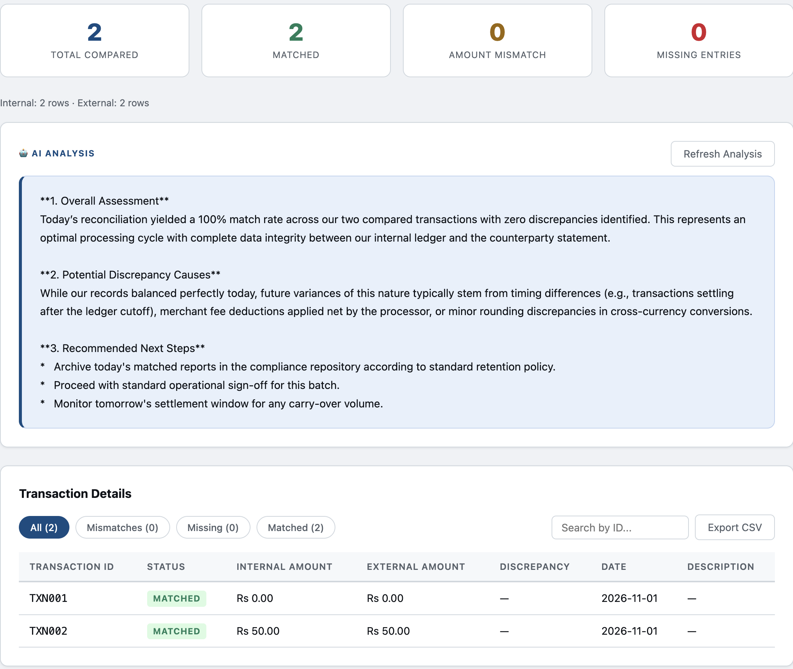

**Severity:** High  
**Found by:** test case T07 (manual testing of the live app)  
**Defect ID:** DEF-02

## Steps to reproduce
1. Open the live app.
2. Upload T07_blank_amount_internal.csv as the internal file (TXN001 amount is blank; TXN002 = 50.00).
3. Upload T07_blank_amount_external.csv as the external file (TXN001 = 0.00; TXN002 = 50.00).
4. Click Run.

Test data: [T07_blank_amount_internal.csv](https://github.com/ritanshugautam/reconx/blob/main/qa/test-data/T07_blank_amount_internal.csv), [T07_blank_amount_external.csv](https://github.com/ritanshugautam/reconx/blob/main/qa/test-data/T07_blank_amount_external.csv)

App: https://reconx-mu.vercel.app

## Expected
TXN001 is flagged as invalid and is not shown as Matched.

## Actual
TXN001 is shown as Matched with Rs 0.00 on the internal side and no warning anywhere. The AI analysis then reported a 100% match rate with "complete data integrity" and advised standard sign-off.

## Evidence

## Likely cause (from reading the source)
backend/routes/reconcile.js, line 24: parseFloat(row[amtKey]) || 0 turns a blank amount into 0, so it is indistinguishable from a real 0.00.

## Environment
Brave on macOS (desktop), live deployment (Vercel frontend + Render backend), tested 16 Nov 2026.

Full report: https://github.com/ritanshugautam/reconx/tree/main/qa
