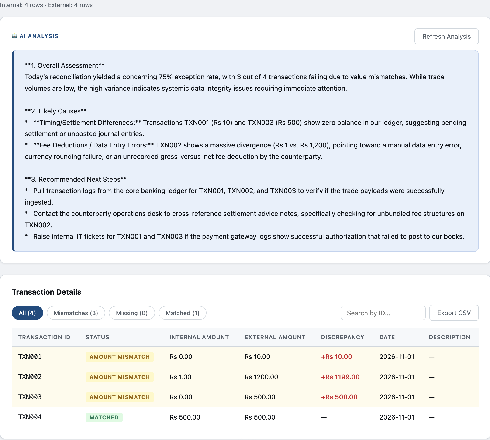

**Severity:** High  
**Found by:** test case T08 (manual testing of the live app)  
**Defect ID:** DEF-03

## Steps to reproduce
1. Open the live app.
2. Upload T08_amount_formats_internal.csv as the internal file (amounts: abc, "1,200.00", a currency symbol followed by 500, and 500 INR).
3. Upload T08_amount_formats_external.csv as the external file (10.00, 1200.00, 500.00, 500.00).
4. Click Run.

Test data: [T08_amount_formats_internal.csv](https://github.com/ritanshugautam/reconx/blob/main/qa/test-data/T08_amount_formats_internal.csv), [T08_amount_formats_external.csv](https://github.com/ritanshugautam/reconx/blob/main/qa/test-data/T08_amount_formats_external.csv)

App: https://reconx-mu.vercel.app

## Expected
No row is silently read as 0. "1,200.00" equals 1200.00 and is Matched; "abc" is flagged or rejected.

## Actual
"abc" was read as Rs 0.00, "1,200.00" as Rs 1.00 (discrepancy +1199.00), the currency-symbol amount as Rs 0.00, and "500 INR" as Rs 500.00 (Matched). There was no warning on any row. The AI analysis explained the errors as pending settlement and data-entry mistakes.

## Evidence

## Likely cause (from reading the source)
backend/routes/reconcile.js, line 24: parseFloat stops at the comma in "1,200.00" (result 1) and returns NaN for text that does not start with a digit; || 0 then hides the NaN.

## Environment
Brave on macOS (desktop), live deployment (Vercel frontend + Render backend), tested 16 Nov 2026.

Full report: https://github.com/ritanshugautam/reconx/tree/main/qa
