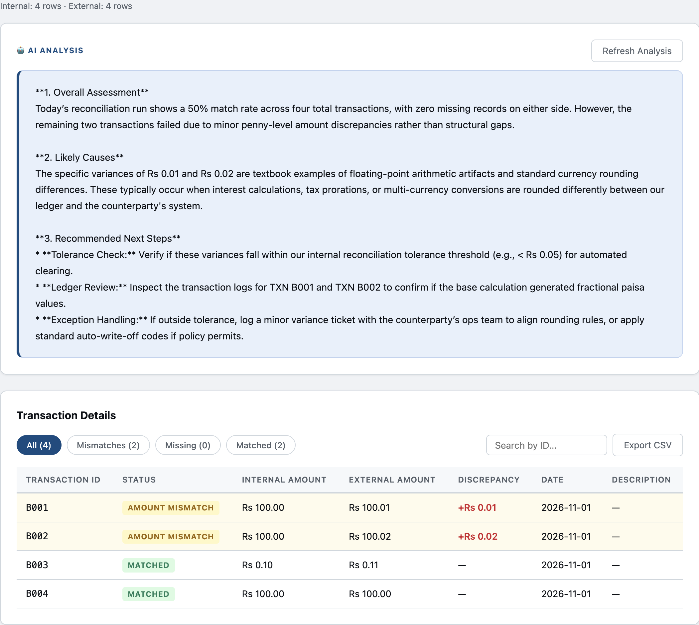

**Severity:** Medium  
**Found by:** test case T03 (manual testing of the live app)  
**Defect ID:** DEF-04

## Steps to reproduce
1. Open the live app.
2. Upload T03_tolerance_internal.csv as the internal file (B001 = 100.00, B002 = 100.00, B003 = 0.10, B004 = 100.00).
3. Upload T03_tolerance_external.csv as the external file (B001 = 100.01, B002 = 100.02, B003 = 0.11, B004 = 100.005).
4. Click Run.

Test data: [T03_tolerance_internal.csv](https://github.com/ritanshugautam/reconx/blob/main/qa/test-data/T03_tolerance_internal.csv), [T03_tolerance_external.csv](https://github.com/ritanshugautam/reconx/blob/main/qa/test-data/T03_tolerance_external.csv)

App: https://reconx-mu.vercel.app

## Expected
Amounts that differ by the same value get the same result: B001 and B003 (both 0.01) are Matched, B004 (0.005) is Matched, B002 (0.02) is Amount Mismatch.

## Actual
B001 (100.00 vs 100.01) is Amount Mismatch but B003 (0.10 vs 0.11) is Matched, although both differ by 0.01. B002 is Amount Mismatch; B004 is Matched. B004's external amount is displayed as 100.00 although the file value is 100.005.

## Evidence

## Likely cause (from reading the source)
backend/routes/reconcile.js, line 78: Math.abs(intRow.amount - extRow.amount) < 0.01 compares floating-point numbers. In JavaScript 100.01 - 100.00 = 0.010000000000005116 (not < 0.01, so mismatch) while 0.11 - 0.10 = 0.009999999999999995 (< 0.01, so matched).

## Environment
Brave on macOS (desktop), live deployment (Vercel frontend + Render backend), tested 16 Nov 2026.

Full report: https://github.com/ritanshugautam/reconx/tree/main/qa
