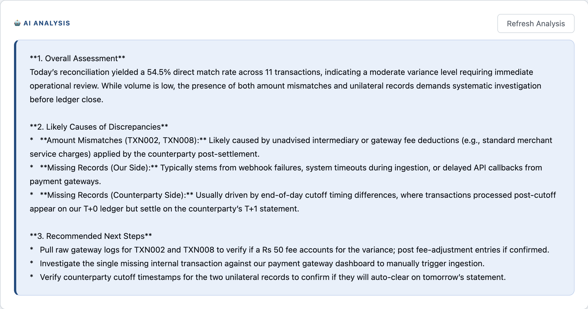
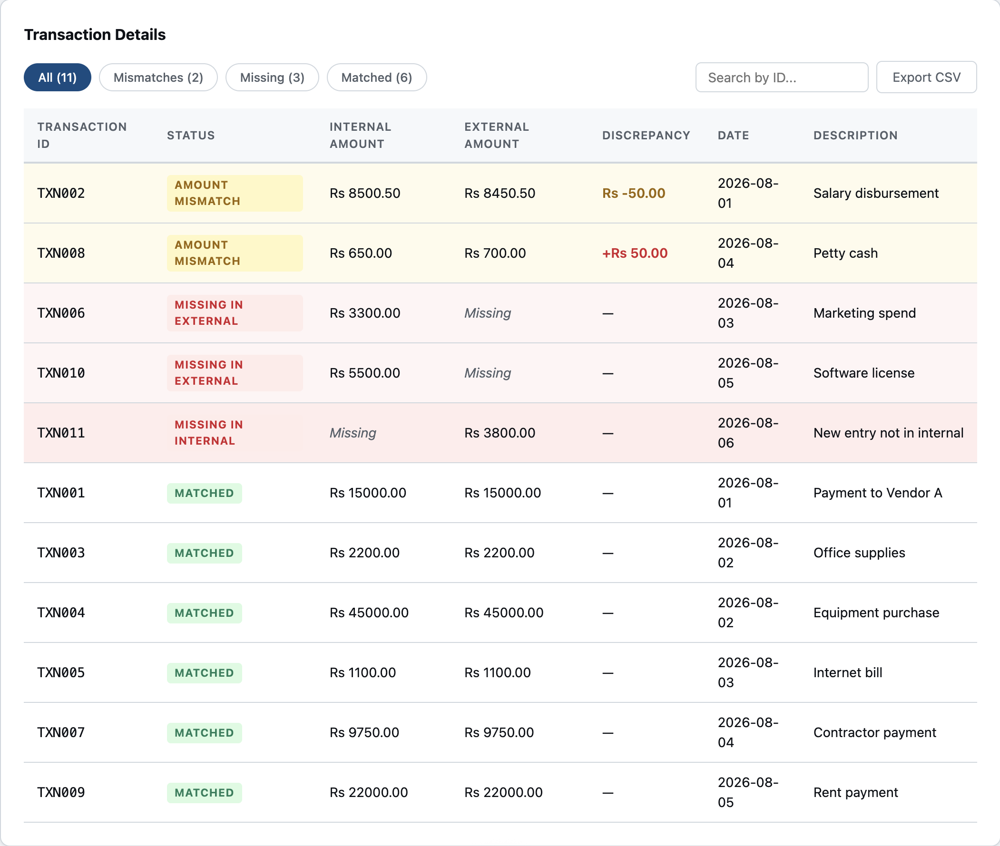

**Severity:** Medium  
**Found by:** test case T01 (manual testing of the live app)  
**Defect ID:** DEF-05

## Steps to reproduce
1. Open the live app.
2. Upload sample_internal.csv as the internal file and sample_external.csv as the external file (both in the repo root).
3. Click Run, then click Explain Discrepancies and read the AI analysis.

Test data: [sample_internal.csv](https://github.com/ritanshugautam/reconx/blob/main/sample_internal.csv), [sample_external.csv](https://github.com/ritanshugautam/reconx/blob/main/sample_external.csv)

App: https://reconx-mu.vercel.app

## Expected
Each suggested cause is consistent with the data: TXN002 external is 50.00 lower than internal, TXN008 external is 50.00 higher.

## Actual
The AI attributed both mismatches to counterparty fee deductions and told the reader to check a Rs 50 fee for both. A fee deduction lowers the external amount, so it cannot explain TXN008, where the external amount is higher (+50.00).

## Evidence

## Likely cause (from reading the source)
backend/routes/explain.js, lines 35-39: the prompt asks for "the most likely causes (be specific - ... fee deductions ...)" and gives the model only counts and sample amounts, with no instruction to say when the data cannot support a cause.

## Environment
Brave on macOS (desktop), live deployment (Vercel frontend + Render backend), tested 16 Nov 2026.

Full report: https://github.com/ritanshugautam/reconx/tree/main/qa
