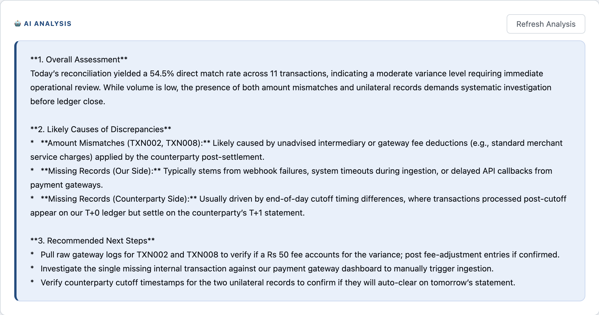

**Severity:** Low  
**Found by:** test case T01 (manual testing of the live app)  
**Defect ID:** DEF-06

## Steps to reproduce
1. Open the live app.
2. Upload sample_internal.csv and sample_external.csv (repo root) and click Run.
3. Click Explain Discrepancies and read the AI analysis box.

Test data: [sample_internal.csv](https://github.com/ritanshugautam/reconx/blob/main/sample_internal.csv), [sample_external.csv](https://github.com/ritanshugautam/reconx/blob/main/sample_external.csv)

App: https://reconx-mu.vercel.app

## Expected
The analysis is displayed formatted: headings and bullets, with no raw markdown symbols.

## Actual
The text shows literal characters such as "**1. Overall Assessment**" and "*" bullets. I saw this on every AI output so far (checked in the T01, T04, T06, T03, T08 and T09 runs).

## Evidence

## Likely cause (from reading the source)
src/components/AIExplainer.jsx, line 78: the model's markdown string is rendered as plain text inside a div.

## Environment
Brave on macOS (desktop), live deployment (Vercel frontend + Render backend), tested 16 Nov 2026.

Full report: https://github.com/ritanshugautam/reconx/tree/main/qa
