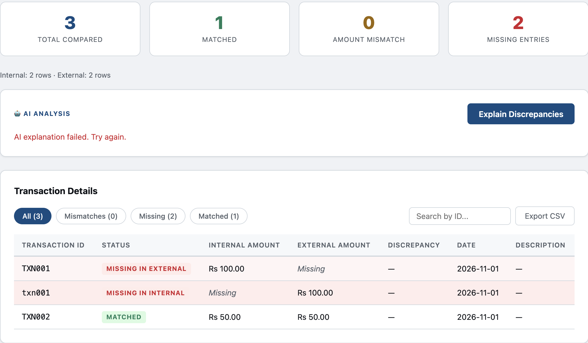

**Severity:** Low  
**Found by:** test case T04 (manual testing of the live app)  
**Defect ID:** DEF-07

## Steps to reproduce
1. Open the live app.
2. Upload T04_id_case_internal.csv as the internal file (TXN001 = 100.00, TXN002 = 50.00).
3. Upload T04_id_case_external.csv as the external file (txn001 = 100.00, TXN002 = 50.00).
4. Click Run.

Test data: [T04_id_case_internal.csv](https://github.com/ritanshugautam/reconx/blob/main/qa/test-data/T04_id_case_internal.csv), [T04_id_case_external.csv](https://github.com/ritanshugautam/reconx/blob/main/qa/test-data/T04_id_case_external.csv)

App: https://reconx-mu.vercel.app

## Expected
TXN001 and txn001 resolve to the same transaction: 2 Matched, 0 Missing.

## Actual
TXN001 shows as Missing in External and txn001 as Missing in Internal, on two separate rows; only TXN002 is Matched. It fails visibly (both rows shown), not silently. The README lists this as a known limitation.

## Evidence

## Likely cause (from reading the source)
backend/routes/reconcile.js, lines 62 and 65: IDs are trimmed with String(r.id).trim() but not case-normalised.

## Environment
Brave on macOS (desktop), live deployment (Vercel frontend + Render backend), tested 16 Nov 2026.

Full report: https://github.com/ritanshugautam/reconx/tree/main/qa
